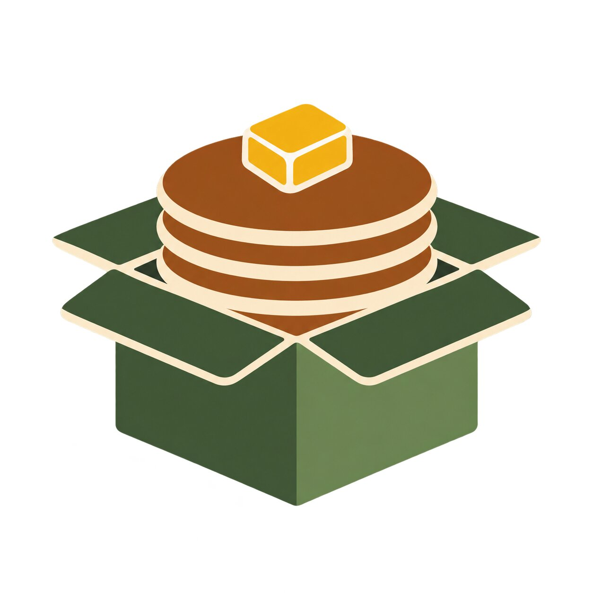

<p align="center"></p>
<h1 align="center">Pancake Client</h1>
<p align="center">A Windows workspace for BONELAB PCVR mods, cameras, and OBS controls.</p>

[](https://github.com/Corbino50211/Pancake-Client/actions/workflows/windows-build.yml)

## Get the first build

Download the portable Windows ZIP from **[Releases](https://github.com/Corbino50211/Pancake-Client/releases/latest)**. Once installed, Pancake Client checks for updates at startup; install and restart from Settings.

For CI artifacts, open **[Actions → Windows build](https://github.com/Corbino50211/Pancake-Client/actions/workflows/windows-build.yml)**, select the latest successful run, and download **PancakeClient-win-x64** under Artifacts. Sign in to GitHub to download artifacts. Extract the entire ZIP and run `PancakeClient.exe`. This is a portable, self-contained Windows x64 app.

**[Setup guide](docs/SETUP.md) · [Camera & OBS guide](docs/OBS.md) · [Roadmap](docs/ROADMAP.md)**

## v0.1 scope

Implemented in this first build:

- Branded WPF desktop app using the supplied pancake-box logo.
- Steam library detection, manual Steam/Meta PC paths, game launch, and persistent settings.
- Local code-mod, plugin, and content inventory; reversible enable/disable operations while the game is closed.
- Profiles that capture enabled states; import/export JSON, automatic pre-apply snapshots, and rollback on a failed apply.
- Live Thunderstore catalog, search, dependency display, mod-page links, and ZIP downloads.
- Content-only ZIP import with archive path validation and no replacement of existing mods.
- User-selected save-folder ZIP backups and live MelonLoader log filtering/export.
- OBS WebSocket 5 connection/authentication, scene switching, recording, streaming, microphone mute, and live output status. Password stays in memory.
- Local current-user named-pipe bridge for the BONELAB companion.
- Companion source with BoneMenu camera/OBS controls, a runtime-built handheld prop with native grab handles and live screen, and native BONELAB spectator output plus an optional 1080p, up-to-5-FPS app preview. Build/install the source against your local game from Settings.

**The Windows desktop app and core checks build in CI. The companion must be built against your installed game's MelonLoader/IL2CPP assemblies and BoneLib. It has not yet been validated in a running BONELAB headset session.** No game assemblies are included.

This release downloads Thunderstore ZIPs; it does **not** automatically resolve or install code-mod dependencies. It links to mod.io; integrated mod.io authentication/downloads, automatic updates, version-pinned packs, avatar/BodyLog editing, and level loading are future milestones. Those screens are labelled accordingly. Profiles are enabled-state snapshots, not isolated game installations.

## Build

Install the .NET 8 SDK on Windows, then from the repository root:

```powershell
.\scripts\Build-Desktop.ps1
```

Build the optional companion after installing compatible MelonLoader and BoneLib, launching BONELAB once, and closing it:

```powershell
.\scripts\Build-Companion.ps1 -GameDir 'C:\Program Files (x86)\Steam\steamapps\common\BONELAB'
```

See the setup guide if your MelonLoader version uses a different runtime or references. Do not install a companion built for a different game patch without testing it.

## Project layout

| Project | Purpose |
|---|---|
| `src/Pancake.Core` | File operations, profiles, downloads, OBS protocol, local IPC |
| `src/Pancake.Desktop` | Windows WPF app and capture window |
| `src/Pancake.Companion` | MelonLoader/BoneLib mod; built with local game references |
| `tests/Pancake.Tests` | Executable integration checks with a simulated OBS server |
| `scripts` | Repeatable Windows build commands |

Sources used for integration: [BoneLib](https://github.com/yowchap/BoneLib), [MelonLoader](https://github.com/LavaGang/MelonLoader), [OBS WebSocket protocol](https://github.com/obsproject/obs-websocket/blob/master/docs/generated/protocol.md), and the public [Thunderstore BONELAB package feed](https://thunderstore.io/c/bonelab/api/v1/package/).

Independent fan project; not affiliated with Stress Level Zero, Ossa, OBS, or the mod repositories. Source and supplied branding have no additional license grant in this initial commit.
